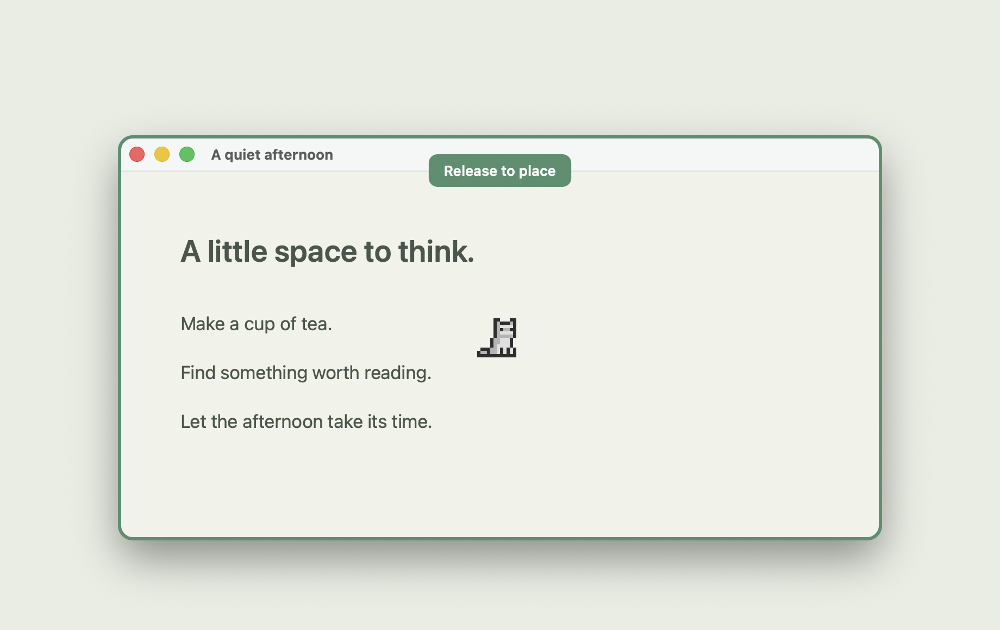
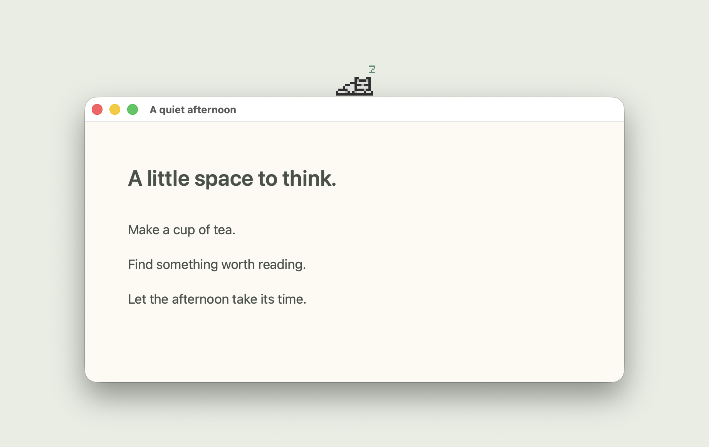
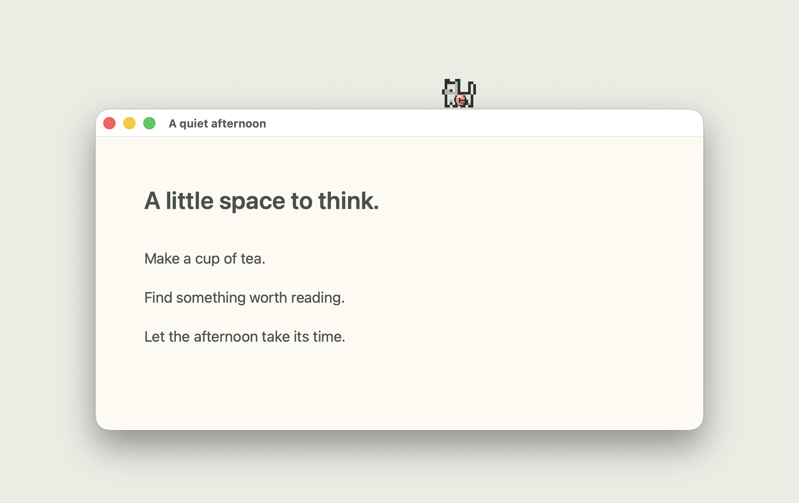

# windowcat

A little cat. A little company.

Give your Mac windows a pixel companion. Drag a cat from the menu bar onto a window, and let it wander, curl up for a nap, or chase a ball while you go about your day.

**macOS 13+ · Apple Silicon · English / 日本語 / 简体中文**

[Download windowcat](https://github.com/kokoro-ele/window-cat/releases/latest) · [中文使用指南](docs/README.zh-CN.md) · [日本語ガイド](docs/README.ja.md)

## A home on any window

Hold the cat icon in the top menu bar, drag it onto a window, and release. Your cat stays with that window as you move or resize it.

## A quiet companion

Let your cat explore the edges, or settle down for a nap. It stays out of the way of your clicks.

## A little time to play

Choose a ball or teaser from the menu when it's time for a break. Give different windows their own cats, with up to 12 companions at once.

*Screenshots use a sample window.*

## Make yourself at home

- Walk, nap, play with a ball, or follow a teaser.
- Adjust walking speed, pause, and turn on automatic naps.
- Switch between English, Japanese, and Simplified Chinese.
- Enjoy it offline, with no account required.

[Get windowcat for Mac →](https://github.com/kokoro-ele/window-cat/releases/latest)

Cat artwork by [Elthen](https://elthen.itch.io/2d-pixel-art-cat-sprites).
